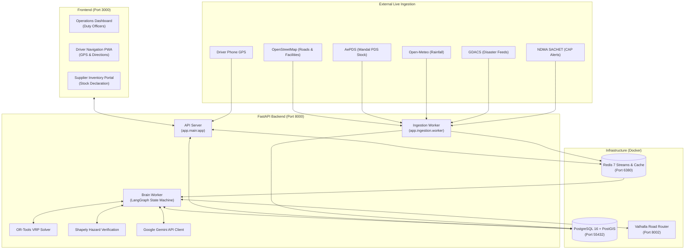

# ReliefRoute (SafePassage) — Project Overview & Architecture

## 1. What the Project Does

**ReliefRoute** (repository name `SafePassage`) is an intelligent, real-time disaster relief routing and logistics coordination system designed specifically for the state of Andhra Pradesh, India. 

When climate or natural hazards strike (such as severe cyclones, heavy rainfall, or flooding):
1. It ingests live government disaster alerts (NDMA SACHET, GDACS, Open-Meteo rainfall).
2. It assesses humanitarian demand in affected zones using census data and Sphere humanitarian standards (litres of drinking water, kilograms of rice, pulses, hygiene kits, medical kits).
3. It queries live stock from local suppliers and Andhra Pradesh's Public Distribution System (AePDS).
4. It computes optimal, safe delivery truck routes that actively avoid hazard polygons using the Valhalla routing engine and Google OR-Tools Vehicle Routing Problem (VRP) solver.
5. An AI Critic node independently tests every planned route using geometric intersection algorithms (Shapely) to ensure trucks never cross active floodwaters or hazards.
6. A Human-in-the-loop (Duty Officer) approves the dispatch plan on an operations dashboard.
7. Drivers receive turn-by-turn navigation in their regional language (Telugu, Hindi, English), and the system monitors their GPS telemetry in real-time, triggering automatic replanning if a truck deviates from the safe corridor or if floodwaters spread across the road.

**Core Design Philosophy:** *"LLMs reason, solvers compute."*
Gemini triages alerts, writes operational briefings, and translates driver instructions. Exact coordinates, distances, cargo weights, and route geometries are computed deterministically by spatial solvers (PostGIS, Shapely, Valhalla, OR-Tools).

---

## 2. Why It Was Developed

Developed for a Generative AI Buildathon focused on **Climate, Resource Infrastructure & Global Supply Resilience**. 

During extreme weather events, humanitarian supply chains frequently break down because:
- Roads wash out or flood dynamically after routes are assigned.
- Food and clean water distribution relies on static spreadsheets and manual phone calls.
- Drivers lack real-time hazard awareness in their primary languages.
- Supplies are double-booked or dispatched from distant depots when local stock was available.

ReliefRoute bridges real-time hazard telemetry directly to automated logistics without mocking data at runtime.

---

## 3. Technology Stack

| Layer | Technologies | Purpose |
|---|---|---|
| **Frontend** | Next.js 16 (App Router), React 19, TypeScript, MapLibre GL | Ops Dashboard, Supplier Portal, Driver Mobile View, Live Map |
| **Backend API** | Python 3.10+, FastAPI, Uvicorn, Pydantic v2 | High-performance async REST API, SSE streaming, authentication |
| **Agentic Workflow** | LangGraph, LangChain Checkpoint Postgres | Orchestration of Sentinel, Needs, Procurement, Planner, and Critic |
| **Generative AI** | Google Gemini (Gemini 2.5/3 Flash) via Gemini API | Alert triage, disaster briefings, multi-lingual driver instruction translation |
| **Spatial Solvers** | Google OR-Tools, Shapely, PyProj | Vehicle Routing Problem (VRP) solver, geometric polygon clearance verification |
| **Routing Engine** | Valhalla (Docker) | Turn-by-turn road graph routing with dynamic polygon avoidance margins |
| **Primary Database** | PostgreSQL 16 + PostGIS 3.4 | Geospatial storage (MultiPolygon hazards, LineString routes, Point facilities) |
| **Cache & Event Bus** | Redis 7 + Redis Streams | Ingestion pub/sub, telemetry stream, agent worker queues, SSE push |
| **Infrastructure** | Docker, Docker Compose, Windows PowerShell | Containerized database, routing engine, and orchestrator scripts |

---

## 4. Complete Folder Structure

```
SafePassage/
├── .gitignore                    # Protects secrets (.env, *.env), python/node build artifacts
├── docker-compose.yml            # Local PostGIS (55432), Redis (6380), Valhalla (8002)
├── netlify.toml / render.yaml    # Cloud deployment configurations
├── README.md                     # Upstream project documentation
├── backend/                      # Python backend service
│   ├── requirements/             # Pinned requirements (base.txt, brain.txt, senses.txt, dev.txt)
│   ├── migrations/               # Incremental database migrations (101-103, 201-209)
│   ├── .env.example              # Template for backend secrets and URLs
│   ├── .env                      # Local backend configuration (ignored by Git)
│   └── app/                      # Application source code
│       ├── main.py               # FastAPI entry point, lifespan, CORS, and middleware
│       ├── core/                 # Shared database, auth, redis, logging, and settings
│       ├── agents/               # Sentinel, Needs, Procurement, Critic, Approval agents
│       ├── graph/                # LangGraph state machine, worker, dispatcher, replanner
│       ├── solvers/              # Google OR-Tools VRP and Shapely polygon verifier
│       ├── routing/              # Valhalla HTTP client and route generation
│       ├── ingestion/            # Senses pollers (SACHET, GDACS, Open-Meteo, AePDS, Overpass)
│       ├── telemetry/            # Vehicle registration, live GPS ingest, deviation detection
│       ├── suppliers/            # Supplier portal, stock declarations, purchase orders
│       ├── accounts/             # User signup, login, session cookies, bcrypt password hashing
│       ├── llm/                  # Gemini backend client, fallback ranker, Langfuse tracing
│       ├── api_brain/            # Plans, approval, orders, and evacuations REST endpoints
│       └── api_senses/           # Hazards, facilities, vehicles, telemetry, and SSE stream
├── contracts/                    # Frozen shared contracts between services
│   ├── db/schema.sql             # Baseline PostGIS database schema and contract views
│   ├── openapi.yaml              # REST API contract definition
│   ├── events.schema.json        # Event schema for Redis Streams
│   └── python/                   # Shared enums and Pydantic event models (reliefroute_contracts)
├── frontend/                     # Next.js 16 Web Application
│   ├── package.json              # Next 16, React 19, MapLibre GL
│   ├── next.config.ts            # API rewrites, Content Security Policy, Standalone output
│   ├── .env.example              # Frontend environment template
│   ├── .env.local                # Local frontend configuration (ignored by Git)
│   └── src/
│       ├── app/                  # Next.js App Router (dashboard, driver, supplier, auth)
│       ├── components/           # UI components (OpsShell, Map, Plans, Fleet, Inventory)
│       └── lib/                  # Client-side API fetchers, session helpers, offline queue
├── env/                          # Upstream environment variable examples
│   ├── brain.env.example         # Brain-specific settings template
│   └── senses.env.example        # Senses-specific settings template
├── infra/                        # Infrastructure, map data scripts, and local runners
│   ├── dev/stack.ps1             # Master Windows PowerShell orchestration script
│   ├── valhalla/                 # Valhalla routing build scripts and config
│   ├── osm/                      # OpenStreetMap data extraction scripts
│   └── deploy/                   # Production Dockerfiles, Caddy reverse proxy, setup script
└── docs/                         # Architecture, guides, and audit reports
```

---

## 5. Architectural Mermaid Diagrams

### Overall Project Architecture



---

### Request Lifecycle & LangGraph Reasoning Loop

```mermaid
sequenceDiagram
    autonumber
    actor NDMA as NDMA SACHET / Operator
    participant Ingest as Ingestion Worker
    participant Redis as Redis Stream
    participant Brain as Brain Worker (LangGraph)
    participant Gemini as Google Gemini
    participant Solvers as OR-Tools & Shapely
    participant DB as PostGIS DB
    actor Officer as Duty Officer (Dashboard)
    actor Driver as Truck Driver (Mobile)

    NDMA->>Ingest: Poll new hazard alert / drill
    Ingest->>DB: Store hazard polygon & details
    Ingest->>Redis: Publish hazard_detected event
    Redis->>Brain: Trigger plan workflow
    Brain->>Gemini: Sentinel Agent: Triage alert severity & affected mandals
    Brain->>DB: Needs Agent: Calculate population & relief demand
    Brain->>DB: Procurement Agent: Query available stock & suppliers
    Brain->>Solvers: Route Planner: Solve VRP around hazard polygons
    Brain->>Solvers: Critic: Shapely geometric intersection check
    Solvers-->>Brain: Clearance verified (or loop back to replan)
    Brain->>Gemini: Generate executive briefing for Duty Officer
    Brain->>DB: Save plan in awaiting_approval status
    Officer->>Brain: POST /api/plans/{id}/approve
    Brain->>DB: Re-check hazards; transition to dispatched
    Brain->>Gemini: Translate driver instructions into Telugu/Hindi
    Brain->>DB: Create purchase orders & delivery routes
    Driver->>DB: Fetch assigned route via mobile web
    Driver->>Ingest: Stream periodic GPS fixes
    Ingest->>Brain: Route Monitor checks deviation / road blockage
```

---

## 6. Frontend Architecture

- **Framework:** Next.js 16 (App Router) with React 19.
- **Routing:**
  - `/(ops)/dashboard`: Operations command centre (Hazards, Plans, Fleet, Evacuations, Sources).
  - `/driver`: Mobile-optimized driver navigation interface with real-time GPS tracking.
  - `/supplier`: Supplier inventory reporting and order fulfillment portal.
  - `/signin`, `/signup`, `/verify`: Authentication and role onboarding flows.
- **Mapping:** MapLibre GL vector maps rendering interactive GeoJSON layers (hazards, routes, facilities, vehicles).
- **Communication:**
  - Client calls `/api/*` which Next.js rewrites to `http://127.0.0.1:8000/api/*`.
  - Live updates via Server-Sent Events (SSE) connected to `/api/stream`.
  - Offline-first queuing for driver GPS telemetry in case of rural connectivity loss.

---

## 7. Backend Architecture

- **Framework:** FastAPI with Python asynchronous event loop.
- **Processes:**
  1. `uvicorn app.main:app --port 8000`: API web server.
  2. `python -m app.ingestion.worker`: Background senses ingestion polling SACHET, GDACS, Open-Meteo, AePDS.
  3. `python -m app.graph.worker`: LangGraph state machine agent worker handling planning and routing.
- **State Machine Nodes (LangGraph):**
  - `sentinel`: Evaluates hazard severity and triggers plans.
  - `needs`: Derives required relief commodities from affected census populations.
  - `procurement`: Matches needs with verified suppliers and PDS godowns.
  - `route_planner`: Calls Valhalla and OR-Tools to solve vehicle pickup and delivery tours.
  - `critic`: Computes Euclidean clearance between vehicle paths and hazard polygons.
  - `brief`: Prompts Gemini for human-readable summaries and action plans.
  - `dispatcher`: Generates order records, PO PDFs, and driver instructions.
  - `route_monitor`: Continuously validates driver GPS against expected routes.

---

## 8. Database Architecture

- **PostgreSQL 16 + PostGIS 3.4:**
  - `hazards`: Stores spatial `MultiPolygon` polygons representing active flood, storm, or cyclone zones.
  - `facilities`: Points representing hospitals, relief shelters, food warehouses, fuel depots.
  - `suppliers` & `stock`: Active inventory snapshots per supplier.
  - `vehicles` & `telemetry`: Vehicle fleet status, driver assignments, and historical GPS traces.
  - `plans`: LangGraph execution runs, demand/allocation JSONB payloads, and approval state.
  - `routes`: Solved vehicle trajectories stored as `LineString` with minimum hazard clearances.
  - `orders` & `order_lines`: Purchase orders linked to routes and suppliers.
  - `agent_events`: Audit trail of every thought, decision, tool call, and solver execution.
  - `accounts`: User authentication table with bcrypt hashed passwords and role assignments.
  - **Contract Views:** `v_active_hazards`, `v_vehicle_status`, `v_available_stock`, `v_source_freshness` allowing clean, decoupled cross-module reads.

